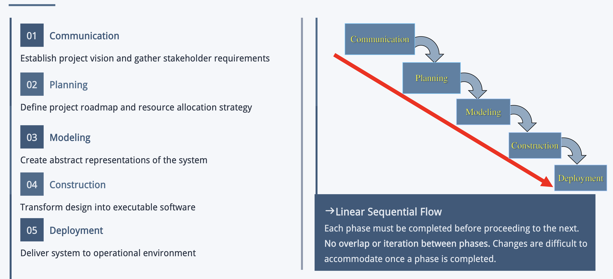
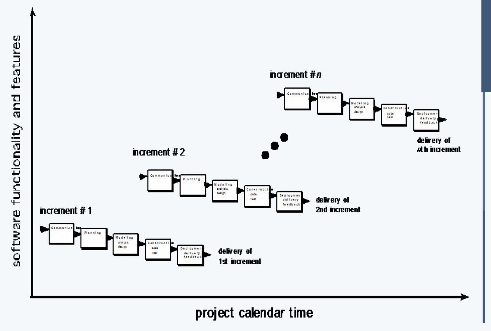
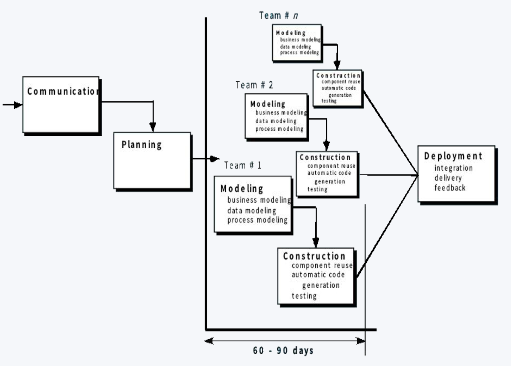
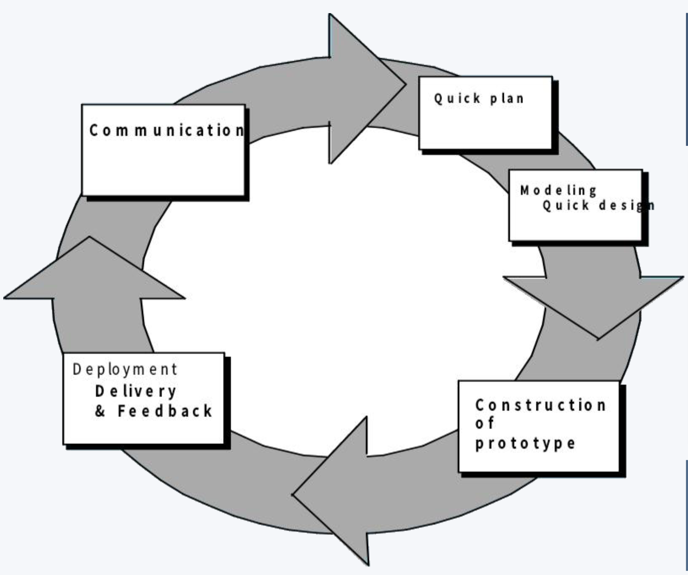
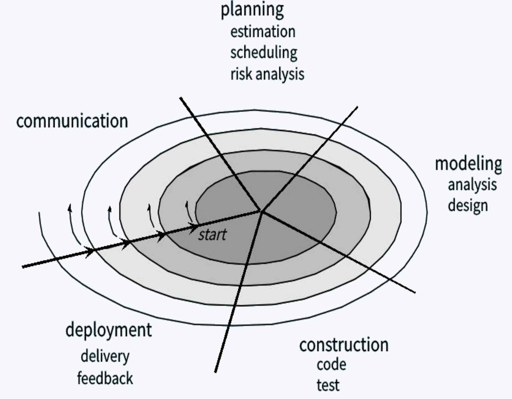

# Process Model

[2 Software Process](./2 Software Process.md)中提到的Process Flow主要描述沟通、计划、建模、构建、部署这五项活动在**时间上如何衔接**，例如依次进行、反复迭代，或部分并行。

Process model是更完整的**开发工作框架**。除了活动怎样衔接，还会说明阶段、各阶段要做的工作、产出、检查点和反馈方式。

## Waterfall Model

通常也称为linear sequential model / classical lifecycle model，从沟通到部署线性进行。

> $communication \rightarrow planning \rightarrow modeling \rightarrow construction \rightarrow deployment$

## Incremental Model

增量：满足用户需求的一个子集，能够完成一个小功能的软件。

增量模型的核心概念就是让软件一步一步地release，每一步都新增一个功能。

### RAD Model (rapid application development)

- 并行同步开发加快速度
- 模块式开发减少重复造轮子

## Evolutionary Model

原型模型 (Prototyping Model) 提供最基础的实现，然后在此基础上一步一步迭代开发。

### Spiral Model

螺旋模型将迭代开发和风险管理相结合，每个螺旋循环都包括：

> $planning \rightarrow risk\ analysis \rightarrow engineering \rightarrow evaluation$
>

## Specialized Model

- Component-Based Development Model（基于构件的开发模型）：优先复用已验证的构件，通过组装与集成构建系统，而不是全部从头开发。
- Formal Method Model（形式化方法模型）：用数学语言精确定义需求，并通过形式化验证检查正确性，适用于安全要求很高的系统。
- Aspect-Oriented Software Development Model（面向方面的软件开发模型）：将日志、安全、事务等横跨多个模块的关注点独立出来，避免这些代码分散在业务逻辑中。
- Unified Process（统一过程，UP）：以用例驱动、以架构为中心，采用迭代和增量开发，常结合 UML 建模。

## UP
UP (Unified Process) 是用例驱动、以架构为中心、采用增量开发的模型，常常和UML结合进行建模。

UP把项目管理分为四个阶段：

1. **Inception（初始）**：明确项目范围和愿景，识别关键用户与需求，判断项目是否可行。

2. **Elaboration（细化）**：深入确定需求，设计并验证核心架构，处理主要风险，制定更可靠的开发计划。

3. **Construction（构建）**：实现剩余功能，并持续测试，形成可交付的软件。

4. **Transition（交付）**：将软件交给用户，部署、培训，并收集使用反馈。

同时每个阶段内部也会自己迭代。

**用例（use case）**描述用户想用系统完成什么，以及用户和系统怎样交互。例如课程管理系统可以有“选课”“查看课表”等用例。

系统由哪些部分组成、它们怎样连接，以及如何满足性能、可靠性、部署等要求。UP 在早期细化阶段重点验证关键架构，避免团队大量实现功能后，才发现整个结构难以扩展或性能不够。
