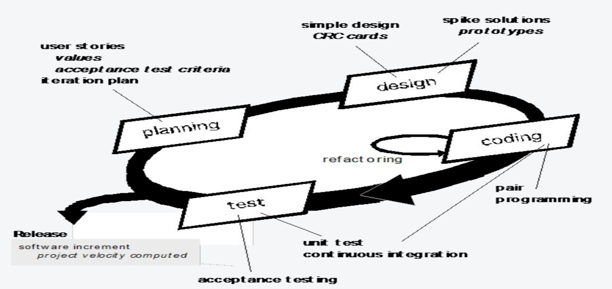

# Agile Sofeware Development

## 什么是敏捷开发

传统过程模型很严谨但是不能适应快速变化，于是产生了敏捷开发。

敏捷开发宣言：

- 个体和互动高于流程和工具
- 可工作的软件高于面面俱到的文档
- 客户合作高于合同谈判
- 响应变化高于遵循计划

## XP (eXtreme Programming)

XP（**Extreme Programming，极限编程**）是一种敏捷开发方法。这里的“极限”是指把一些有效的软件开发实践做得更彻底，例如持续测试、频繁集成和及时收集用户反馈。

XP包含以下四个步骤：

1. Planning：客户用简短的 **User Stories（用户故事）**描述功能，例如“作为学生，我想查看课表，以便安排学习”。团队估算故事的工作量、挑选本轮要做的故事，再根据实际完成速度（**velocity，团队速率**）规划后续版本。
2. Design：保持设计简单，只解决当前需要；遇到难题时，先做小型技术试验（**Spike Solution**）；之后通过 **Refactoring（重构）**改善代码结构，但不改变对外功能。
3. Coding：先写测试再写实现代码（**Test-First Development / TDD**）；两位开发者结对编程；代码经常集成，尽早发现各部分组合时的问题。
4. Testing：每天运行单元测试，并让客户定义验收测试，检查功能是否满足用户目标。

## 别的Agile Software Development

- ASD (Adaptive Software Development，自适应软件开发)：通过“推测（speculation）—协作（collaboration）—学习（learning）”循环开发；每轮根据反馈调整后续计划并发布增量。
- Dynamic Systems Development Method（DSDM，动态系统开发方法）：先做可行性分析和基础规划，再通过迭代开发、评审与部署逐步交付系统。
- Scrum Methodology（Scrum）：以 Sprint 为短周期，团队通过 Sprint Planning、Daily Scrum、Sprint Review 和 Retrospective 计划、检查并改进工作。
- Lean Software Development（精益软件开发）：从客户角度定义价值、梳理价值流、建立顺畅流动、按需求拉动工作，并持续消除浪费、追求改进。
- KanBan Software Development（看板开发）：用看板可视化工作状态，例如 Idea、To do、Doing、Done，帮助团队看清任务流转。
