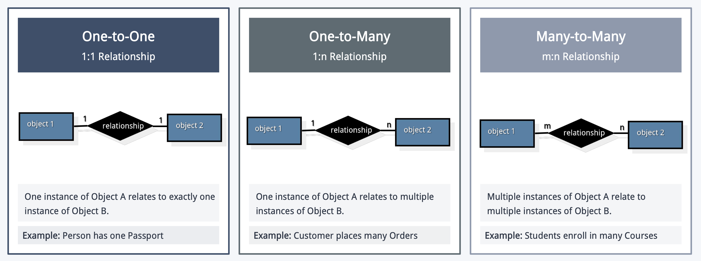
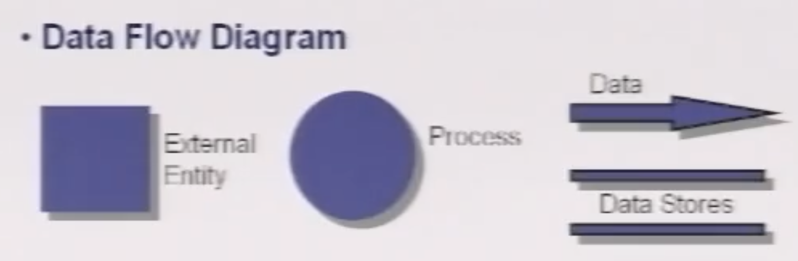

# Requirement

## 什么是需求

### Requirement 和 Specification 的区别

- **Requirement（需求）**：相关方对系统提出的条件、能力或限制，说明系统**需要做什么**，以及必须满足什么约束。它来自客户、用户、业务方、工程团队或法规等。
- **Specification（需求规格说明）**：把需求整理、细化后形成的正式描述，较具体地列出系统的功能、约束和特性，供开发、测试和验收时共同参照。

可以把两者理解为：**Requirement 是“要解决什么问题、系统需要达到什么”**；**Specification 是把这些要求明确记录下来，形成可供实现和验证的依据**。需求强调目标，规格说明强调清晰、完整地表达这些目标；规格说明不应过早把需求写成某种具体实现方案。

例如，需求可以是“用户应能快速查询可预约的号源”；规格说明则进一步明确“查询结果应显示医生、科室和可预约时段，并在正常负载下 2 秒内返回”。后者把较概括的需要细化成更明确、可检查的描述。

### 为什么需求重要

- **沟通的起点**：需求工程建立客户、用户与开发团队之间的对话，并持续到后续建模等工作中
- **连接问题与解决方案**：把相关方的需要转化为可执行的开发依据
- **确保理解真实需要**：团队需要弄清项目、产品、流程和相关人员的目标、约束与成功标准，才能交付真正满足用户需要的系统
- **降低项目失败风险**：需求工程做得不好，容易造成误解、返工、预算超支和相关方不满

## 需求工程

### 需求工程的七项任务

1. **启始（Inception）**：了解问题背景，识别相关方并明确项目目标。
2. **需求获取（Elicitation）**：通过访谈、会议、观察等方式收集需求与约束。
3. **需求细化（Elaboration）**：分析并整理需求，建立用例、数据或行为模型。
4. **需求协商（Negotiation）**：协调冲突、权衡优先级，确定可行且各方认可的范围。
5. **规格说明（Specification）**：将需求清楚地记录为文档、模型、用例或原型等。
6. **需求验证（Validation）**：检查需求是否正确、完整、一致、可行且可测试。
7. **需求管理（Management）**：持续跟踪需求及变更，维护其状态和可追踪性。

#### Inception

开始：

- Identify stakeholders: "Who else do you think I should talk to?"
- Recognize multiple points of view: End users, IT staff, management
- Work towards collaboration

通过以下方法激发需求：

- Collaborative Meetings
- Rules & Preparation
- Structured Agenda
- Facilitator Role

**Quality Function Deployment (QFD)：衡量需求的标准，最大化客户的满意度。**

- Normal requirements: Explicitly stated by the customer and easily understood.
- Expected requirements: So fundamental that customers assume they exist.
- Exciting requirements: Beyond customer expectations and provide delight when present.

#### Elicitation

#### 确定用例 (use-case)

用例（Use Case）：是一组用户场景的集合，用于描述系统的使用过程。每个场景代表一个参与者（Actor）与系统之间为实现特定目标而进行的一次具体交互。

参与者（Actor）：是指以某种方式与软件系统进行交互的人员或设备。

#### 建立分析模型

分析模型从多个互补视角描述同一个系统，课件主要介绍数据、流程、场景和面向对象/类建模。它们共同帮助团队理解需求，不是彼此替代的开发过程模型。

- **数据建模 (Data Modeling)**：描述数据对象、属性及对象间关系，常用 ERD。
- **流程建模 (Flow-Oriented Modeling)**：描述数据如何输入、转换和输出，常用 DFD，也可用控制流图描述事件。
- **场景建模 (Scenario-Based Modeling)**：描述参与者如何与系统交互以达成目标，常用用例、活动图和泳道图。
- **面向对象/类建模 (Object-Oriented / Class-Based Modeling)**：描述分析类、对象协作及其动态行为，常用类图、序列图、状态图和 CRC 模型。

#### Elaboration

#### Negotiation

#### Specification

#### Validation

#### Requirements management

## 需求分析

### Rules of Thumb

- **聚焦业务需求 (Focus on Domain Requirements)**：保持较高抽象层次，描述系统要解决的问题，避免过早涉及实现细节。
- **每个元素都要有价值 (Add Value with Each Element)**：模型中的内容应帮助理解系统的信息、功能或行为。
- **基础设施细节留到设计阶段 (Delay Infrastructure Considerations)**：分析时先回答“做什么”，暂缓讨论“怎么做”。
- **减少耦合 (Minimize Coupling)**：降低模型元素之间的依赖，提升系统的可维护性和灵活性。
- **为相关方提供价值 (Provide Stakeholder Value)**：模型应能让不同角色理解并用于沟通。
- **保持简单 (Keep It Simple)**：只保留表达需求所必需的内容，避免不必要的复杂度。

### Domain Analysis

**领域分析（Domain Analysis）**是系统地研究某一业务领域，识别其中共通的知识、需求和模式，并整理成模型，供具体软件项目参考和复用。

- **基本步骤**：定义领域范围（Define）→ 收集代表性应用与资料（Collect）→ 分析共性模式（Analyze）→ 建立领域对象和分析模型（Develop）。
- **信息来源**：技术文献、已有应用、客户调查、领域专家意见，以及当前和未来需求。
- **主要产出**：领域分析模型、类分类体系、功能模型、复用标准和领域术语。
- **作用**：促进组件与模式复用、统一团队的领域语言，并提升后续开发效率。

**例子：**开发医院系统前，先整理患者、医生、科室、预约等通用概念和典型流程，再将这些领域知识用于具体医院项目。

有以下几种分析模型 (analysis model)：

- 数据建模 data modeling
- 流程建模 flow-oriented modeling
- 场景建模 scenario-based modeling
- 面向对象建模 object-oriented modeling

### 数据建模 (Data Modeling)

Data Modeling（数据建模）：识别系统中有哪些重要数据对象、它们有什么属性，以及对象之间有什么关系。它描述的是系统里的数据结构，不着重描述数据如何被处理。

#### 数据对象

数据对象是系统需要记录或操作的事物，由一组属性描述。例如，图书对象可以有 ISBN、书名、作者、出版社等属性。对象通常需要能被唯一识别，并且对系统的功能有必要。

#### 对象间的关系

 关系表示系统需要记住的对象间事实。比如“某人拥有某辆车”。如果一个人可能拥有多辆车，这就是一对多关系。

 关系不只是两个对象同时出现，而是它们之间有业务意义、系统需要保存的信息。

 **基数（cardinality）**表示一个对象的实例可以关联另一个对象的几个实例：

- 1:1：一个人对应一本护照
- 1:n：一个客户可以下多个订单
- m:n：多个学生可以选多门课程

### 流程建模 (Flow-Oriented Modeling)

流程建模把系统看作**信息转换器**，重点表示数据对象在系统中如何流动并被处理，补充用例和类图所提供的视角。它描述逻辑上的“做什么”，不规定具体实现方式。

#### 数据流图 (Data Flow Diagram, DFD)

DFD 的基本元素：

- **外部实体 (External Entity)**：系统边界之外的数据来源或接收方，如用户、传感器或其他系统。
- **处理过程 (Process)**：转换输入数据并产生输出数据的处理活动。
- **数据流 (Data Flow)**：实体、过程和数据存储之间传递的数据，箭头应标注有意义的数据名称。
- **数据存储 (Data Store)**：供系统保存、读取的数据，如数据库或文件。

DFD 通常从**上下文图/Level 0**开始，把整个系统画成一个过程，展示系统边界及主要输入、输出；再逐层分解为 Level 1、Level 2 等子过程。分解时要保持各层之间的数据流一致（balanced），并持续细化，直到每个过程都表达一个清晰、单一的功能。DFD 表示数据流和转换，不表示循环、判断顺序等程序控制逻辑。

**过程规格说明 (Process Specification, PSPEC)** 用文字、结构化描述、决策表或流程图等方式说明 DFD 中某个过程的处理逻辑，补足图中没有展开的细节；它仍描述过程“做什么”，而不是代码如何实现。

#### 控制流图 (Control Flow Diagram)

控制流图补充说明由传感器、开关、中断或数据条件触发的**事件**，以及这些事件如何控制系统过程。课件示例中，控制流以虚线表示，并叠加在 DFD 上；DFD 的实线仍表示数据流。可把它理解为：DFD 说明数据如何经过处理，控制模型说明什么事件会影响处理。

### 场景建模 (Scenario-Based Modeling)

场景建模从用户或外部系统的角度描述一段“使用过程”，围绕参与者与系统的交互，确认系统是否能帮助参与者达成有价值的目标。

#### 用例 (Use Case)

- **参与者 (Actor)**：与系统交互的角色，可以是人、设备或外部系统；同一个人也可能在不同场景中扮演不同角色。
- **用例 (Use Case)**：描述参与者为达成一个目标而与系统进行的一系列交互。
- 编写用例时应考虑参与者执行的主要任务、系统信息的获取/产生/修改、外部环境变化，以及异常情况或意外变化。

#### 用例图、活动图与泳道图

- **用例图 (Use-Case Diagram)**：展示系统边界、参与者、用例及其关系，适合概览系统范围和功能。
- **活动图 (Activity Diagram)**：以流程图式的 UML 表示补充用例，展示活动、决策及控制流。
- **泳道图 (Swimlane Diagram)**：在活动流程上标明每项动作由哪个参与者或分析类负责，便于厘清职责交接。

### 面向对象建模 (Object-Oriented Modeling)

面向对象分析把需求转化为**分析类及其协作关系**。分析阶段描述业务概念和系统应有的行为，不应把分析模型写成代码结构或数据库设计。

一个类的组成包含：

1. attributes: A collection of data values that describe a class
2. operations: Also called methods and services , define behaviors

#### 分析类与类图

识别问题领域中的概念类及其属性、关系。课件将分析类分为三类：

- **实体类 (Entity Class)**：表示业务对象并保存持久信息，如 Customer、Product。
- **边界类 (Boundary Class)**：处理系统与用户、设备或外部系统之间的交互，如界面或 API。
- **控制类 (Control Class)**：协调一个用例或工作流程，负责组织处理、校验和实体对象的更新。

#### 序列图与状态图

- **序列图 (Sequence Diagram)**：按时间顺序展示单个用例中参与者和对象之间传递的消息，说明对象如何协作完成场景。消息应能追溯到用例步骤，并与类的职责相符。
- **状态图 (State Diagram)**：描述一个重要实体从创建到结束的生命周期，包括状态、触发事件、条件和状态转换。它关注单个对象内部如何随业务事件改变状态；序列图关注多个对象之间如何交互，两者互补。

#### CRC 模型与分析包

- **CRC (Class-Responsibility-Collaboration) 模型**：用“类、职责、协作者”整理每个类负责什么、需要和哪些类合作。可通过走查用例检查是否有遗漏的类或职责。
- **分析包 (Analysis Package)**：把相关模型元素按功能、子系统或层次分组，帮助组织大型分析模型，并隐藏不需要对外暴露的内部细节。

面向对象分析通常会反复校验用例、类图、序列图和状态图之间的一致性，再把这些成果整合成完整的 OOA 分析模型，为后续设计提供依据。
