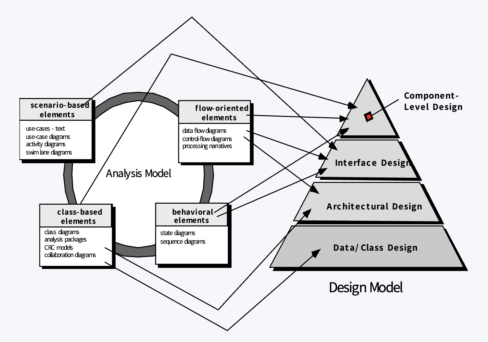

# Design Engineering

## 从分析模型转化为设计模型

输入是需求分析阶段的用例、数据流图、类图、状态图等；设计阶段进一步确定：

- 系统整体如何划分（**架构设计**）
- 数据和类如何组织（**数据／类设计**）
- 模块之间如何交互（**接口设计**）
- 每个模块内部如何工作（**组件级设计**）
- 软件最终如何分布到硬件上（**部署设计**）

这些设计部分合起来构成**设计模型**。设计会逐步细化，也会根据发现的问题返回修改，不一定一次完成。

## Design Quality

设计需要实现分析模型里的明确需求，也要考虑用户隐含的需要；同时要让开发者能据此编程、测试者能据此验证、维护者能理解系统结构：

- **F**unctionality：功能
- **U**sability：易用性
- **R**eliability：可靠性
- **P**erformance：性能
- **S**upportability：可维护、可测试和可扩展等支持能力

这些目标有时需要权衡，例如提升性能可能增加系统复杂度。

## Design Concepts

**设计时应遵循以下概念要求：**

- **抽象（Abstraction）**：抓住设计的核心，隐藏不必要的细节。包括数据抽象、过程抽象和控制抽象。
- **逐步求精（Refinement）**：从高层设计开始，逐步分解并补充细节，直到设计足以指导实现。
- **模块化（Modularity）**：将系统划分为职责明确的模块，便于理解、并行开发、复用和维护。
- **信息隐藏（Information Hiding）**：通过受控接口提供模块能力，隐藏其内部数据和实现，减少局部修改对其他部分的影响。
- **功能独立（Functional Independence）**：让模块专注于明确的单一功能，并尽量减少模块间依赖；通常追求**高内聚、低耦合**。
- **架构（Architecture）**：描述软件系统的重要组成部分、它们的组织方式和交互关系，并考虑性能、可靠性、安全性、扩展性等质量属性。
- **设计模式（Design Patterns）**：记录经过验证、可重复使用的设计方案，说明它适用的问题、结构、参与者、协作方式及可能的权衡。
- **重构（Refactoring）**：在不改变软件外部行为的前提下，调整和改善内部结构，提高可读性、可维护性和扩展性。

  